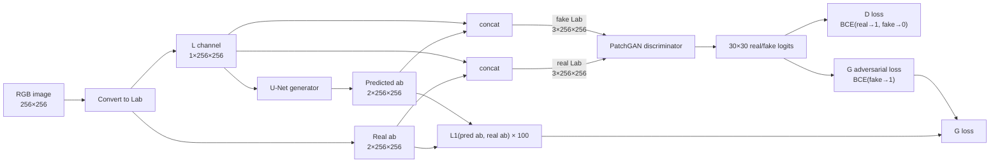
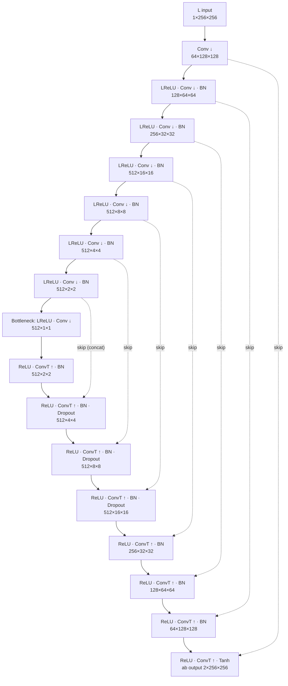
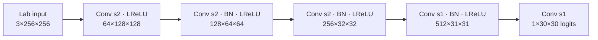

# ImageColorization

Colorize black-and-white photos with deep learning. A U-Net generator predicts the
`a*b*` color channels from the `L*` (lightness) channel of an image in Lab color space.
It is trained as a conditional GAN against a PatchGAN discriminator, in the style of pix2pix.

## Installation

Requires Python 3.11+.

```shell
git clone https://github.com/lekenzi/ImageColorization.git
cd ImageColorization
uv sync            # or: pip install -e .
```

PyTorch picks the best available device automatically: Apple Silicon (MPS), CUDA or CPU.

## Usage

### Train

```shell
uv run colorize-train --epochs 20 --batch-size 16
```

If you pass no `--data`, the trainer downloads fastai's COCO sample (~10k images). To use
your own images instead, point `--data` at a folder of `.jpg`/`.png` files:

```shell
uv run colorize-train --data path/to/images --num-images 5000 --epochs 20
```

The trainer writes a checkpoint to `checkpoints/model.pth` after every epoch. It also saves
progress plots (input / prediction / ground truth) to `outputs/`. Run
`uv run colorize-train --help` for all options.

### Pretrained weights

A trained checkpoint is attached to the [v0.1.0 release](https://github.com/lekenzi/ImageColorization/releases/tag/v0.1.0):

```shell
mkdir -p checkpoints
gh release download v0.1.0 -p model.pth -D checkpoints
# or: curl -L -o checkpoints/model.pth https://github.com/lekenzi/ImageColorization/releases/download/v0.1.0/model.pth
```

### Colorize an image

```shell
uv run colorize --input old_photo.jpg --output old_photo_color.png --checkpoint checkpoints/model.pth
```

The generator runs at 256×256. The predicted colors are then upsampled onto the
full-resolution lightness channel, so the output keeps the input's original size.

## Model architecture

For the full write-up, including the papers this builds on and how it differs from them, see
[docs/MODEL.md](docs/MODEL.md).

### Training setup

The generator colorizes the `L` channel. The discriminator then scores `L` stacked with
either the predicted or the real `ab` channels. The generator loss is the GAN loss plus
100× the L1 distance to the real colors.



### U-Net generator

Eight stride-2 downsampling blocks with a skip connection at every level. The three
512-channel decoder blocks nearest the bottleneck use dropout of 0.5. Shapes below are for
a 256×256 input.



### PatchGAN discriminator

The discriminator classifies overlapping patches instead of the whole image. Each of the
30×30 output logits sees a 70×70 receptive field.



## Project layout

```
image_colorizer/
├── __init__.py              # get_device()
├── dataset.py               # Lab-space dataset and train/val dataloaders
├── helper.py                # loss meters, Lab -> RGB, progress plots
├── train.py                 # ColorizationTrainer + colorize-train CLI
├── visualize.py             # single-image inference
├── cli.py                   # colorize CLI
└── model/
    ├── __init__.py          # MainModel (GAN wrapper, optimisation step)
    ├── unet.py              # U-Net generator
    ├── patch_discriminator.py
    ├── gan_loss.py
    └── init_weights.py
tests/                       # shape and smoke tests (CPU, no dataset needed)
image-colorization.ipynb     # original exploration notebook
```

## Development

```shell
uv sync
uv run ruff check . && uv run ruff format --check .
uv run pytest
```

## License

Apache 2.0. See [LICENSE](LICENSE).
