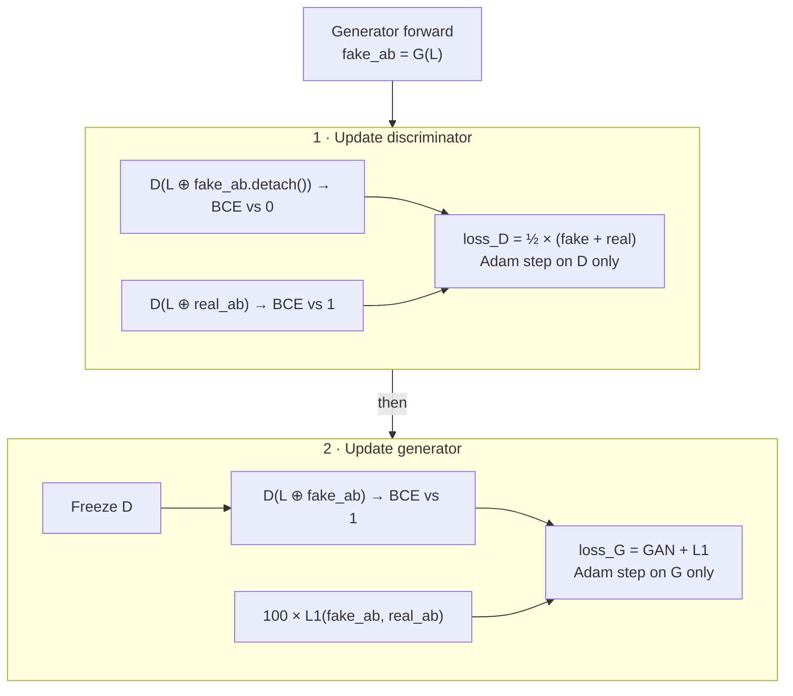

# How the model works

The model takes the lightness of a photo and predicts its two missing color channels. It is a
pix2pix-style conditional GAN: a U-Net generator paints the colors, and a PatchGAN discriminator
judges whether each patch of the result looks real.

The work happens in **Lab color space**. `L` is lightness, which is the grayscale image, and
`a`/`b` are the two color axes (green–red and blue–yellow). Because the grayscale input already
*is* the `L` channel, the network never has to reproduce structure or brightness. It only has to
predict 2 numbers per pixel, not 3.

- **Input:** `L`, 1×256×256, scaled to [-1, 1]
- **Output:** `ab`, 2×256×256, in [-1, 1] (Tanh)
- **Final image:** input `L` + predicted `ab`, converted back to RGB

Training combines two signals. An L1 loss keeps colors close to the ground truth. An adversarial
loss pushes them to look plausible rather than a safe, washed-out average.

## Papers and sources

The main reference is **pix2pix**. The code itself follows Moein Shariatnia's PyTorch
colorization tutorial, which applies pix2pix to colorization in Lab space.

| Source | What this repo takes from it |
| --- | --- |
| [Image-to-Image Translation with Conditional Adversarial Networks](https://arxiv.org/abs/1611.07004), Isola, Zhu, Zhou, Efros, CVPR 2017 ("pix2pix") | The training recipe: a conditional GAN, a U-Net generator with skips, a 70×70 PatchGAN discriminator, GAN loss + λ·L1 with λ = 100, Adam at lr 2e-4 with β1 = 0.5, N(0, 0.02) weight init, and halving the D loss |
| [U-Net: Convolutional Networks for Biomedical Image Segmentation](https://arxiv.org/abs/1505.04597), Ronneberger, Fischer, Brox, MICCAI 2015 | The encoder–decoder shape with a skip connection at every resolution, which pix2pix adopted for its generator |
| [Colorful Image Colorization](https://arxiv.org/abs/1603.08511), Zhang, Isola, Efros, 2016 | Framing colorization as predicting the Lab color channels from `L`. Zhang et al. use classification with class rebalancing; this repo uses L1 + GAN regression instead |
| [Image Colorization with U-Net and GAN Tutorial](https://github.com/moein-shariatnia/Deep-Learning/tree/main/Image%20Colorization%20Tutorial), Moein Shariatnia ([article](https://towardsdatascience.com/colorizing-black-white-images-with-u-net-and-conditional-gan-a-tutorial-81b2df111cd8)) | The code layout (`UnetBlock`, `PatchDiscriminator`, `GANLoss`, `MainModel`), the fastai COCO sample with 10,000 images split 8,000/2,000, and the `L/50 − 1` and `ab/110` normalisation |

## Data pipeline

Each image becomes a pair of tensors, `L` (input) and `ab` (target), both scaled to roughly
[-1, 1]. See `image_colorizer/dataset.py`.

1. **Source.** With no `--data`, the trainer downloads fastai's COCO sample
   (`URLs.COCO_SAMPLE`, the `train_sample` folder). Otherwise it globs `.jpg`, `.jpeg` and `.png`
   from the given folder.
2. **Subset and split.** A fixed seed (`default_rng(123)`) picks `--num-images` paths (default
   10,000), then splits them 80/20 into train and validation.
3. **Resize.** Bicubic resize to 256×256. Training adds a random horizontal flip; validation does not.
4. **Convert to Lab.** `skimage.color.rgb2lab` gives `L` in [0, 100] and `a`, `b` in about [-110, 110].
5. **Normalise.** `L = L / 50 − 1` and `ab = ab / 110`, so both land in [-1, 1] and match the
   generator's Tanh output range.

DataLoaders shuffle the training set, use 4 workers by default, and pin memory only on CUDA.

## Generator: U-Net

The generator is an 8-level U-Net with 54,409,858 parameters that maps `L` (1×256×256) to `ab`
(2×256×256). It is built recursively in `image_colorizer/model/unet.py`. Each `UnetBlock` wraps
the block below it and concatenates its own input onto its output, which creates the skip
connection.

Every down step is a 4×4 conv with stride 2, halving the resolution. Every up step is a 4×4
transposed conv with stride 2, doubling it.

| Level | Encoder output (down) | Decoder output (up) | Decoder input after skip concat |
| --- | --- | --- | --- |
| 1 (outermost) | Conv → 64×128×128 | ReLU · ConvT · **Tanh** → 2×256×256 | 128×128×128 |
| 2 | LReLU · Conv · BN → 128×64×64 | ReLU · ConvT · BN → 64×128×128 | 256×64×64 |
| 3 | LReLU · Conv · BN → 256×32×32 | ReLU · ConvT · BN → 128×64×64 | 512×32×32 |
| 4 | LReLU · Conv · BN → 512×16×16 | ReLU · ConvT · BN → 256×32×32 | 1024×16×16 |
| 5 | LReLU · Conv · BN → 512×8×8 | ReLU · ConvT · BN · **Dropout** → 512×16×16 | 1024×8×8 |
| 6 | LReLU · Conv · BN → 512×4×4 | ReLU · ConvT · BN · **Dropout** → 512×8×8 | 1024×4×4 |
| 7 | LReLU · Conv · BN → 512×2×2 | ReLU · ConvT · BN · **Dropout** → 512×4×4 | 1024×2×2 |
| 8 (bottleneck) | LReLU · Conv → 512×1×1 | ReLU · ConvT · BN → 512×2×2 | 512×1×1 (no skip) |

Read the decoder bottom-up. Each up step takes the concatenation of the level below's output and
that level's encoder feature, so the channel count doubles before every transposed conv.

- **Skips carry detail.** Edges and textures pass straight across, so the deep layers only have
  to decide colors, not reconstruct the image.
- **LeakyReLU (0.2) down, ReLU up**, as in pix2pix.
- **No BatchNorm** on the first conv, the bottleneck conv, or the output layer. The bottleneck is
  1×1, so BN there would be computed over a single spatial position.
- **Dropout 0.5** on the three 512-channel decoder blocks nearest the bottleneck.
- **Tanh output** keeps `ab` in [-1, 1], matching the `ab / 110` normalisation.

## Discriminator: PatchGAN

The discriminator outputs a 30×30 grid of real/fake logits, one per overlapping 70×70 patch,
instead of a single score for the image. It has 2,765,633 parameters, about 5% of the
generator's. See `image_colorizer/model/patch_discriminator.py`.

Its input is the full Lab image: `L` concatenated with either the real or the predicted `ab`.
This makes it a *conditional* discriminator. It judges whether these colors fit *this* grayscale
image, not just whether they look like colors in general.

| Layer | Op (4×4 kernels, padding 1) | Output |
| --- | --- | --- |
| Input | `L` + `ab` | 3×256×256 |
| 1 | Conv stride 2 · LeakyReLU (no BN) | 64×128×128 |
| 2 | Conv stride 2 · BN · LeakyReLU | 128×64×64 |
| 3 | Conv stride 2 · BN · LeakyReLU | 256×32×32 |
| 4 | Conv stride 1 · BN · LeakyReLU | 512×31×31 |
| 5 | Conv stride 1, no activation | 1×30×30 logits |

Scoring patches pushes the generator toward locally realistic color and texture. The L1 loss
already handles global, low-frequency color, so the discriminator only needs to look locally.
This is the 70×70 PatchGAN that pix2pix found to work best.

Parameter counts and output shapes above were checked by running both networks on a 256×256 input.

## Losses and training loop

Each batch runs one discriminator update, then one generator update. The generator is scored on
fooling the discriminator plus staying within L1 distance of the true colors, with the L1 term
weighted 100×. See `MainModel.optimize()` in `image_colorizer/model/__init__.py`.

**Discriminator loss.** Binary cross-entropy on logits (`BCEWithLogitsLoss`) over all 30×30
outputs, halved so D learns more slowly than G:

$$\mathcal{L}_D = \tfrac{1}{2}\Big[\mathrm{BCE}\big(D(L, ab),\, 1\big) + \mathrm{BCE}\big(D(L, G(L)),\, 0\big)\Big]$$

**Generator loss.** The non-saturating GAN loss (label the fakes as real) plus weighted L1:

$$\mathcal{L}_G = \mathrm{BCE}\big(D(L, G(L)),\, 1\big) + 100 \cdot \lVert G(L) - ab \rVert_1$$

The L1 term dominates early in training and gives a stable but desaturated, brownish result. The
GAN term pushes colors toward saturated, plausible choices. `GANLoss` also supports `lsgan` (MSE)
mode, but `MainModel` uses `vanilla`.

**Order within a step:**

1. `fake_ab = G(L)` once per batch.
2. **D step.** Enable D's gradients and score `L ⊕ fake_ab.detach()` against 0 and
   `L ⊕ real_ab` against 1. Then backprop and step `opt_D`. `.detach()` stops this loss from
   reaching G.
3. **G step.** Disable D's gradients and re-score `L ⊕ fake_ab` against 1, add 100 × L1, then
   backprop and step `opt_G`.

| Setting | Value | Where |
| --- | --- | --- |
| Optimizer | Adam, lr 2e-4, betas (0.5, 0.999), for both G and D | `MainModel.__init__` |
| λ (L1 weight) | 100 | `lambda_L1` |
| Weight init | Conv weights N(0, 0.02), biases 0; BatchNorm weights N(1, 0.02), biases 0 | `init_weights.py` |
| Batch size | 16 (CLI default) | `--batch-size` |
| Epochs | 10 (CLI default) | `--epochs` |
| LR schedule | None, constant | — |

`ColorizationTrainer` logs running averages of all six losses every 200 iterations. It also saves
an input / prediction / ground-truth grid for a fixed validation batch to `outputs/`, and writes
`checkpoints/model.pth` (the `MainModel` state dict, both networks) after every epoch.

## Inference

The generator always runs at 256×256. Its color prediction is then stretched back over the
full-resolution lightness, so the output keeps the input's original size and sharpness. See
`ColorizationVisualizer.colorize()` in `image_colorizer/visualize.py`.

1. Load the image as RGB, even if it is grayscale, and keep the original.
2. Make a bicubic 256×256 copy, convert it to Lab, and normalise `L` to [-1, 1].
3. Put G in `eval()` mode, which turns off dropout and makes BatchNorm use running statistics,
   and predict `ab` under `torch.no_grad()`.
4. Compute `L` from the **original-resolution** image.
5. Bilinearly upsample the 2×256×256 `ab` to the original height and width.
6. Undo the normalisation (`L` → (L + 1) × 50, `ab` → ab × 110), concatenate, run `lab2rgb`,
   clip to [0, 1], and save as 8-bit.

This works because human vision is far more sensitive to detail in lightness than in color.
Low-resolution chroma over full-resolution luma is the same trick JPEG chroma subsampling uses.

## What this repo changes

The core network and losses are unchanged from pix2pix. What differs is the task setup (Lab
colorization, as in the tutorial), a few training simplifications, and the engineering around it.

**Compared with the pix2pix paper:**

| Aspect | pix2pix paper | This repo |
| --- | --- | --- |
| Input → output | Image → image, 3 → 3 channels in most tasks | Lab `L` → `ab` (1 → 2 channels); D sees 3-channel Lab |
| Colorization data | ImageNet, ~6 epochs, batch size 4, mirroring only | 8,000 COCO images, 10 epochs by default, batch size 16, resize to 256 + horizontal flip |
| Other tasks | Batch size 1 ("instance normalization"), 200 epochs, random jitter (resize to 286, crop to 256) + mirroring | Not applicable |
| Dropout at test time | Kept on: "applied on several layers of our generator at both training and test time" | Off (`net_G.eval()`), so output is deterministic |
| BatchNorm at test time | Uses test-batch statistics | Uses running statistics (`eval()`) |
| Architecture, losses, λ = 100, Adam settings, init, 70×70 PatchGAN | — | Same as the paper |

**Compared with the Shariatnia tutorial:**

| Aspect | Tutorial | This repo |
| --- | --- | --- |
| Generator | Two variants: a from-scratch U-Net, and a ResNet18-backbone U-Net (fastai `DynamicUnet`) pretrained with L1 before GAN training | From-scratch U-Net only. `MainModel(net_G=...)` still accepts a custom generator |
| Form | One notebook | Installable package (`uv`/pip) with `colorize-train` and `colorize` CLIs |
| Data | COCO sample only | COCO sample by default, or any folder of `.jpg`/`.jpeg`/`.png` via `--data` |
| Device | CUDA | Auto-selects Apple MPS, then CUDA, then CPU; pins memory only on CUDA |
| Inference | 256×256 results | Upsamples `ab` onto the original-resolution `L`, so output keeps the input size |
| Checkpoints and progress | In-notebook | `checkpoints/model.pth` after every epoch; progress grids saved to `outputs/` |
| Quality | — | CPU shape and smoke tests, ruff lint/format, CI with CPU-only torch |

## Limitations and possible next steps

| Limitation | Effect | Possible fix |
| --- | --- | --- |
| Generator trained from scratch on 8,000 images | Muted, sepia-leaning colors; weak on rare objects | Pretrained ResNet/ConvNeXt encoder; pretrain G with L1 only before the GAN phase |
| No validation loss or metric | Progress is judged only by eye from the `outputs/` grids | Log validation L1 each epoch; add a colorfulness metric or FID |
| Checkpoint holds weights only | Training cannot resume with optimizer state | Also save `opt_G`, `opt_D` and the epoch |
| Constant learning rate | No late-training refinement | Linear decay over the last half, as in the official pix2pix code |
| Deterministic output (dropout off) | One answer per image; no alternative colorings | Optional flag that keeps dropout on |
| `lab_to_rgb` runs per image on CPU through skimage | Slow progress plots and inference on large batches | A batched torch Lab→RGB conversion |
| Fixed 256×256 color prediction | Color bleeding across fine edges at high resolution | Larger training size, or guided upsampling of `ab` |
